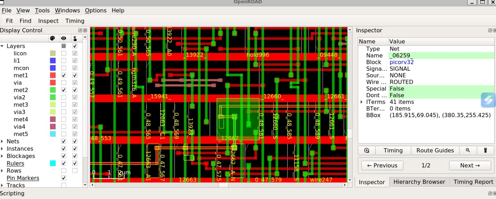
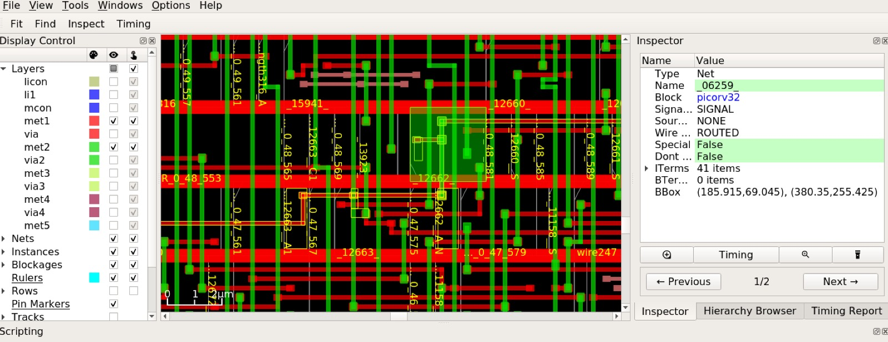
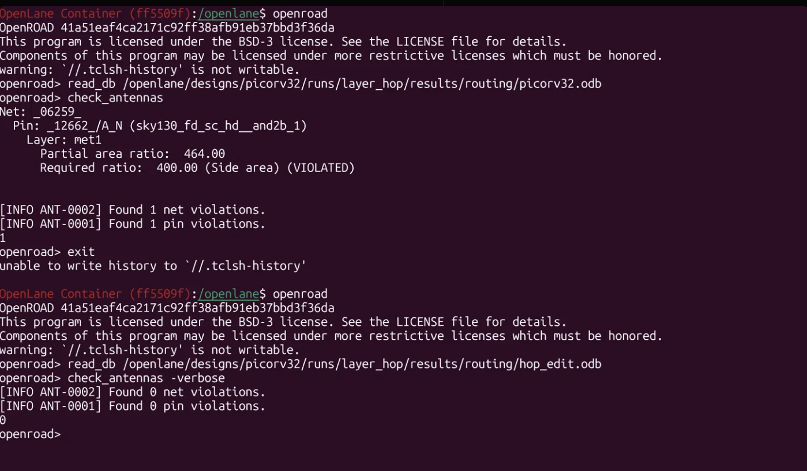

# Fixing an Antenna Violation by Layer Hopping (picorv32, sky130)

Fixing one antenna violation in a finished chip layout by rerouting a tiny piece of wire. No extra cells were added.

**Result:** the antenna check went from 1 violation to 0. The design rule check (DRC) and layout-vs-schematic check (LVS) are both still clean.

## What is an antenna violation?
During chip manufacturing, long metal wires collect electric charge while they are being made. If that charge reaches a transistor gate, it can damage it. The tools measure this as a ratio, and it must stay under a limit.

## Setup
- Design: picorv32 (a small RISC-V processor)
- Flow: OpenLane, sky130 technology, all open-source tools
- Run name: `layer_hop`

## The problem
The signoff report (`reports/before_antenna_violators.rpt`) showed one violation:

- Net `_06259_`, pin `_12662_/A_N`, on layer met1
- Ratio 464, but the limit is 400

## Why it happened
Net `_06259_` connects one driver to 20 gates. Most of it runs on higher metal layers, but one long stretch (about 76 um) of the lowest metal layer (met1) was connected straight to the gate of `_12662_`. While met1 is being manufactured, that long wire collects charge and sends it to the gate.

The net already had a protection diode on this pin, but it was connected through a higher layer (met2). That layer does not exist yet while met1 is being made, so the diode could not help.

## The fix: layer hopping
Instead of connecting the long met1 wire directly to the gate, the connection goes up to met2 for a very short hop (0.68 um) and comes back down. Now, while met1 is being made, the long wire is not connected to the gate, so it cannot damage it.

The change is only three lines in the routing file (`eco/hop_edit.patch`):
1. A short met1 wire is replaced by a short met2 wire.
2. One via (a vertical connection between layers) is added.
3. The long met1 wire is shortened to start at the hop.

No cell and no net were added. The exact steps are in `eco/commands.md`.

## Results
| Check | Before | After |
|---|---|---|
| Antenna check (OpenROAD) | 1 violation | 0 violations |
| DRC (Magic) | 0 errors | 0 errors |
| LVS (Netgen) | 0 errors | 0 errors |
| Netlist compared to the original | n/a | identical |

Proof is in `reports/` (text outputs) and `screenshots/` (layout views).

## Limitations
- LVS was run in the same mode as the original run, not from the full GDS layout.
- Timing was not re-checked. The change is tiny (about 0.7 um of wire on one net), so no effect is expected, but it was not measured.
- Large files (GDS, ODB, DEF) are not in this repo.

## Layout before and after

Left: original routing. Right: after the layer hop. Net `_06259_` is highlighted, with only met1 and met2 shown.

